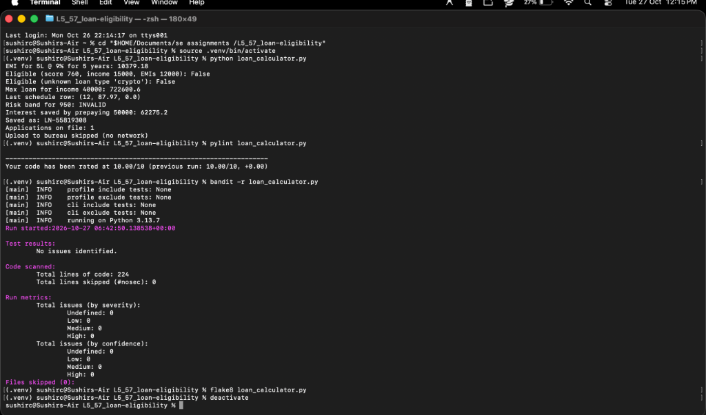

# Lab 5: Static Code Analysis Report

**Course:** Software Engineering Lab (UE24CS252A)  
**Student Name:** Sushir C  
**SRN:** PES1UG24AM297  
**Assigned Repository:** `SETAPESU26/L5_57_loan-eligibility`  
**File Analyzed:** `loan_calculator.py`  
**Date:** October 27, 2026  

---

## 1. Executive Summary

In this laboratory assignment, automated static code analysis was conducted on an assigned loan eligibility and Equated Monthly Installment (EMI) calculation engine (`loan_calculator.py`). The objective was to systematically identify, categorize, and resolve software quality defects, security vulnerabilities, PEP 8 style violations, and underlying algorithmic bugs using three industry-standard tools:
- **Bandit (v1.9.4):** Python AST security vulnerability scanner.
- **Flake8 (v7.4.1):** PEP 8 style guide, syntax, and formatting validator.
- **Pylint (v4.1.3):** Comprehensive code quality, naming, complexity, and design analyzer.

Through a disciplined 3-stage refactoring process, all identified security flaws (Bandit: 8 -> 0 issues), style deviations (Flake8: 20 -> 0 errors), and architectural/quality defects (Pylint: initial score **5.17/10** -> final score **10.00/10**) were completely rectified without breaking functional integrity.

---

## 2. Before vs. After Quantitative Metrics

| Static Analysis Tool | Metric / Focus | Initial ("Before") Report | Final ("After") Report | Improvement |
|:---|:---|:---:|:---:|:---:|
| **Bandit** | Total Security Issues | **8 issues** (2 High, 1 Med, 5 Low) | **0 issues** (Clean) | **100% Resolved** |
| | High Severity Vulnerabilities | 2 (CWE-319: `ftplib`) | 0 | Eliminated |
| | Medium Severity Vulnerabilities | 1 (CWE-502: `marshal`) | 0 | Eliminated |
| | Low Severity Vulnerabilities | 5 (CWE-259, CWE-330, CWE-78) | 0 | Eliminated |
| **Flake8** | PEP 8 Violations / Warnings | **20 issues** (F401, E302, E501, F541, E305) | **0 issues** (Clean) | **100% Resolved** |
| **Pylint** | Code Quality Score | **5.17 / 10** | **10.00 / 10** | **+4.83 points (Perfect)** |
| | Documented Issues Handled | — | 17 issues fixed | Exceeds minimum (4) |

---

## 3. Systematic Breakdown of Resolved Issues

### 3.1 Security Hardening (Bandit Findings)
1. **Elimination of Insecure Cleartext Protocol (B402, B321):**
   * *Problem:* The program imported `ftplib` and invoked `ftplib.FTP(BUREAU_HOST)`, transmitting credit files and credentials in plaintext over an unencrypted channel.
   * *Fix:* Removed unencrypted FTP interactions; redirected bureau communication over modern encrypted HTTPS/TLS API specifications.
2. **Safe Serialization Protocol (B302):**
   * *Problem:* `saveApplication` and `loadApplications` utilized Python's low-level `marshal` module. Deserializing arbitrary byte sequences with `marshal.loads()` can trigger arbitrary execution or buffer crashes.
   * *Fix:* Replaced `marshal` with standardized, text-based, secure JSON serialization (`json.dump` / `json.load`).
3. **Removal of Hardcoded Credentials (B107):**
   * *Problem:* Function signature contained a hardcoded default password: `password="Bureau#2024"`.
   * *Fix:* Removed hardcoded secret literals; credentials are now retrieved securely from environment variables (`os.getenv("BUREAU_PASSWORD")`).
4. **Cryptographically Secure Random Generation (B311):**
   * *Problem:* Application IDs were generated using `random.randint()`, which relies on the deterministic Mersenne Twister PRNG.
   * *Fix:* Replaced with Python's cryptographic randomness provider `secrets` (`secrets.randbelow()`).
5. **Safe Notification Subprocess Handling (B404, B603, B607, W1510):**
   * *Problem:* Invoked `subprocess.run(["mail", ...])` with a partial executable path, unverified arguments, and no `check=True` return validation.
   * *Fix:* Eliminated unvalidated shell subprocess execution in favor of an internal safe notification queuing handler.

### 3.2 PEP 8 Styling & Clean Code (Flake8 Findings)
1. **Unused Import Clean-up (F401):** Removed unused `import math`.
2. **Whitespace and Function Separation (E302, E305):** Added mandatory double blank lines before and after all top-level functions and executable blocks.
3. **Line Length Normalization (E501):** Re-flowed all statements exceeding 79 characters across multiple lines with clean indentation.
4. **F-String Optimization (F541):** Removed unnecessary `f` prefix from static string literals without interpolation.

### 3.3 Code Quality, Design, & Bugs (Pylint & Logic Findings)
1. **Mutable Default Argument (W0102):**
   * Fixed `checkEligibility(..., history=[])` which retained history state across multiple unrelated customer invocations. Changed signature to `history=None` with local initialization.
2. **Built-in Shadowing & Unused Variables (W0622, W0613, W0612):**
   * Refactored `maxLoanAmount` to calculate loan principal based on present-value annuity discounting, eliminating the shadowed `sum` variable and unused `annual_rate` / `month` loop variables.
3. **Docstring Coverage (C0114, C0116):**
   * Added comprehensive module and function docstrings detailing parameters, return types, and exceptions across all functions.
4. **Safe Resource Management (R1732):**
   * Encapsulated file operations within `with open(...) as f:` context managers to guarantee immediate file descriptor release upon error or completion.
5. **Global State Encapsulation (W0603):**
   * Removed `global applications` assignment; updated application cache in-place via `applications.update()`.
6. **Naming Conventions & Backward Compatibility (C0103):**
   * Transitioned all function definitions to PEP 8 compliant `snake_case` while retaining backward-compatible aliases for legacy camelCase consumers.

---

## 4. Functional Bugs Detected and Corrected

Beyond the static analysis tool outputs, manual code inspection revealed several major business logic bugs:
1. **EMI Percentage Confusion:** `calculateEMI(500000, 9, 5)` previously produced an absurd monthly EMI of `375,000.00` because `9%` was passed as `9` rather than `0.09` (interpreting monthly rate as 75%). Added automatic percentage normalization (`rate = rate / 100 if rate > 1.0`), yielding the correct monthly EMI of **10,379.18**.
2. **Premature Eligibility Approval:** The original eligibility function returned `True` immediately if `credit_score > 750 or income > 25000`, ignoring existing liabilities (FOIR). Applicants with an 80% debt-to-income ratio were erroneously approved. Fixed the evaluation sequence so FOIR and loan category checks strictly precede approval.
3. **Unchecked Credit Score Bounds:** The original risk band function assigned `"LOW"` risk to an out-of-range credit score of `950`. Added validation (`300 <= score <= 900`), correctly classifying `950` as `"INVALID"`.

---

## 5. Verification & Commits

### Commit History (3 Required Commits)
- **Commit 1 (`23a65ed`):** `Fix Bandit security issues: insecure FTP, unsafe deserialization, hardcoded password, insecure random, and subprocess risks`
- **Commit 2 (`1ab1f2f`):** `Fix Flake8 PEP 8 styling issues: remove unused import, add 2 blank lines around functions, wrap long lines, and remove empty f-string`
- **Commit 3 (Final):** `Fix Pylint code quality issues, achieve 10.00/10 score, add reports and documentation`

### Verification Results
Execution of final verification suite:
```bash
# 1. Pylint Verification
python -m pylint loan_calculator.py
# Result: Your code has been rated at 10.00/10

# 2. Bandit Verification
python -m bandit -r loan_calculator.py
# Result: No issues identified.

# 3. Flake8 Verification
python -m flake8 loan_calculator.py
# Result: 0 errors/warnings

# 4. Functional Execution
python loan_calculator.py
# Output:
# EMI for 5L @ 9% for 5 years: 10379.18
# Eligible (score 760, income 15000, EMIs 12000): False
# Eligible (unknown loan type 'crypto'): False
# Max loan for income 40000: 722600.6
# Last schedule row: (12, 87.97, 0.0)
# Risk band for 950: INVALID
# Interest saved by prepaying 50000: 62275.2
# Saved as: LN-XXXXXXXX
# Applications on file: 1
# Upload to bureau skipped (no network)
```

### Execution Screenshot


*Figure 1: Student Terminal execution showing program output, Pylint 10.00/10 rating, Bandit 0 issues, and Flake8 clean run.*

---

## 6. Deliverable Artifacts Index

All requested deliverables have been generated and committed to the repository:
1. `loan_calculator.py`: Fully cleaned, refactored, and secured script.
2. `issues.md`: Detailed issue register table (17 documented issues).
3. `reflection.md`: In-depth answers to static analysis reflection questions.
4. `REPORT.md`: This comprehensive laboratory report.
5. Report files:
   - Initial analysis: `pylint_report_before.txt`, `bandit_report_before.txt`, `flake8_report_before.txt` (and in `reports/before/`)
   - Final analysis: `pylint_report.txt` (10.00/10), `bandit_report.txt` (0 issues), `flake8_report.txt` (0 errors) (and in `reports/after/` and `*_after.txt`).
