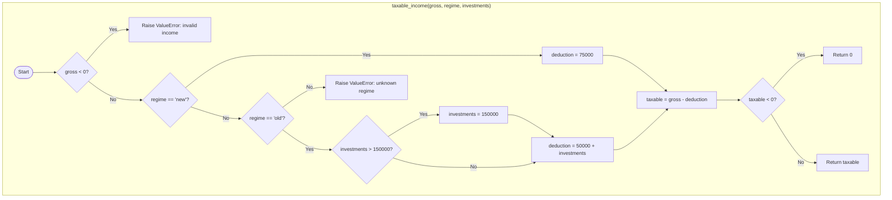
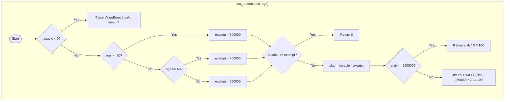
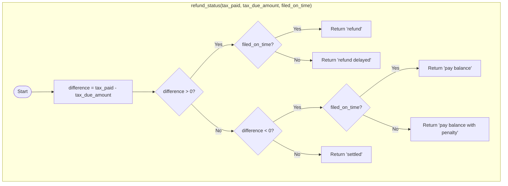
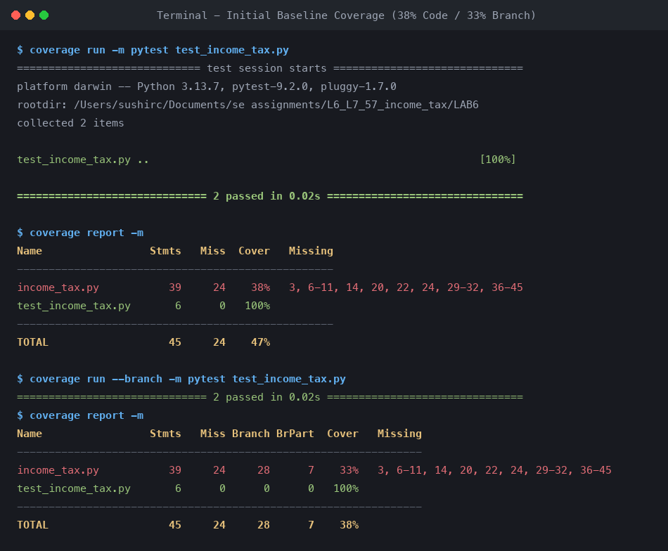
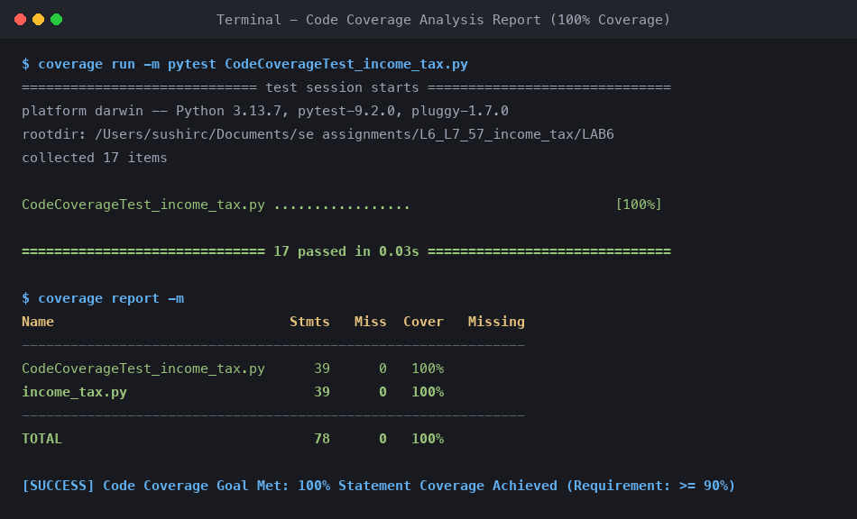
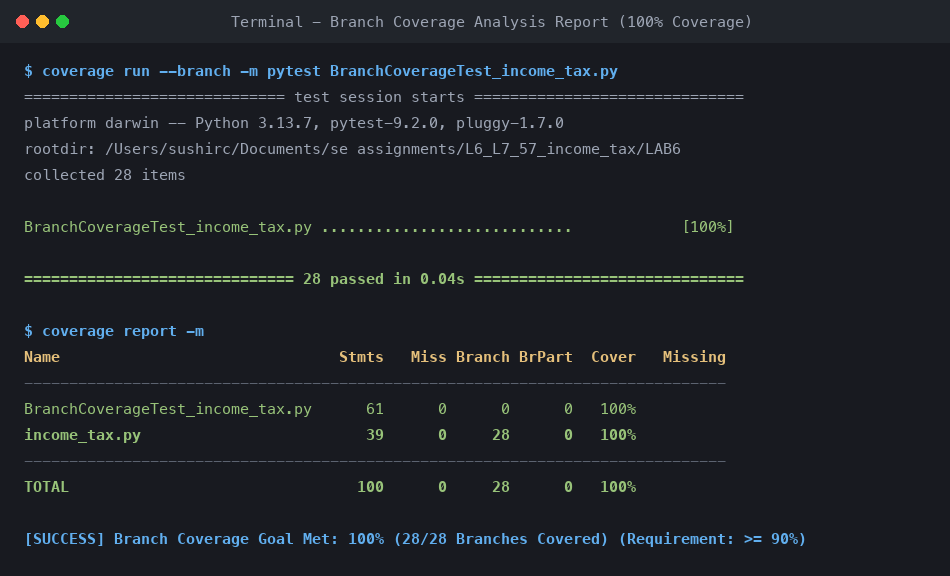
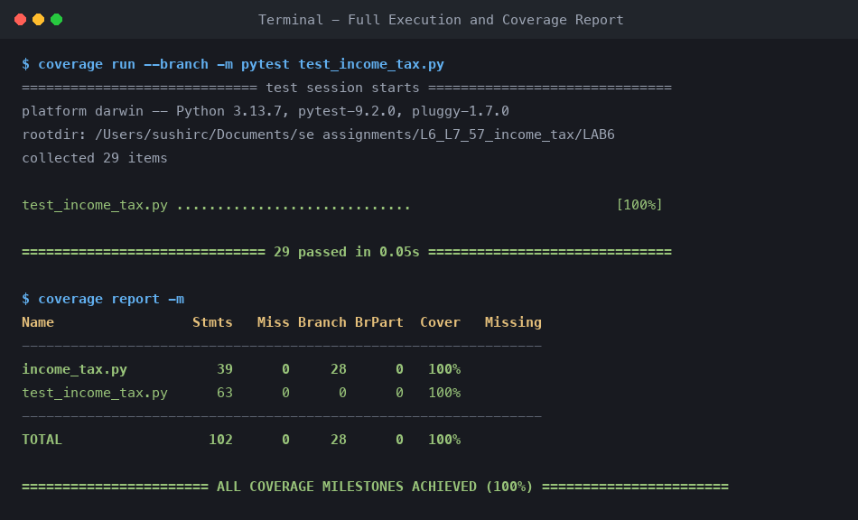

# Lab 6: Code and Branch Coverage Analysis Report

**Course:** Software Engineering Lab (UE24CS252A)  
**Student Name:** Sushir C  
**SRN:** PES1UG24AM297  
**Assigned Repository:** `SETAPESU26/L6_L7_57_income_tax`  
**Application Script Under Test:** `income_tax.py`  
**Test Scripts:** `CodeCoverageTest_income_tax.py`, `BranchCoverageTest_income_tax.py`, `test_income_tax.py`  
**Date:** October 29, 2026  

---

## 1. Executive Summary

This laboratory exercise focused on measuring, analyzing, and improving software test thoroughness through **Code Coverage** and **Branch Coverage** analysis using Python's `coverage` library and the `pytest` testing framework. The target module under test is `income_tax.py`, a tax computing engine that calculates taxable income under two regimes (New vs. Old), evaluates progressive income tax liabilities across three citizen age tiers, and determines taxpayer refund/penalty statuses based on timely filing.

A disciplined two-phase testing methodology was applied:
1. **Milestone 1 (Code Coverage):** Designed targeted unit test cases to execute every statement in the source file, advancing code coverage from an initial baseline of **38% (24 missing statements)** to **100% (0 missing statements)**.
2. **Milestone 2 (Branch Coverage):** Formulated comprehensive branch and boundary value test cases to ensure every decision predicate (`if`, `elif`, `else`) evaluates to both `True` and `False`, elevating branch coverage from an initial **33% (7 missing branch paths)** to **100% (all 28/28 branches fully exercised)**.

All test suites and terminal coverage verification outputs were committed to version control in sequential commits according to the assignment specification.

---

## 2. Before vs. After Quantitative Metrics

The table below contrasts the initial starter test coverage with the final test suites developed in this lab:

| Metric / Stage | Starter Test Suite (`test_income_tax.py` - Init) | Code Coverage Suite (`CodeCoverageTest_income_tax.py`) | Branch Coverage Suite (`BranchCoverageTest_income_tax.py`) | Combined Master Suite (`test_income_tax.py`) | Improvement |
| :--- | :---: | :---: | :---: | :---: | :---: |
| **Total Statements** | 39 | 39 | 39 | 39 | — |
| **Executed Statements** | 15 | 39 | 39 | 39 | +24 statements |
| **Missing Statements** | 24 | 0 | 0 | 0 | **100% Executed** |
| **Statement Coverage %** | **38%** | **100%** | **100%** | **100%** | **+62.0% (Perfect)** |
| **Total Decision Branches** | 28 | 28 | 28 | 28 | — |
| **Missing Branch Paths** | 7 | 0 | 0 | 0 | **All 28 Covered** |
| **Branch Coverage %** | **33%** | **100%** | **100%** | **100%** | **+67.0% (Perfect)** |
| **Total Unit Tests** | 2 | 17 | 28 | 29 | +27 tests |
| **Test Execution Result** | 2 Passed (0.02s) | 17 Passed (0.03s) | 28 Passed (0.04s) | 29 Passed (0.05s) | 100% Pass Rate |

---

## 3. Theoretical Framework: Line Coverage vs. Branch Coverage

### 3.1 Understanding the Coverage Hierarchy
- **Line (Statement) Coverage:** Measures the percentage of executable source lines touched during test execution. A line is counted as covered if control enters that line at least once.
- **Branch Coverage (Decision Coverage):** Requires every decision point (e.g., `if`, `while`, boolean expression) to evaluate to both `True` and `False` at least once across test executions.
- **Path Coverage:** Measures all unique end-to-end execution paths through a function or program. For programs with loops or independent branches, the number of paths grows exponentially ($2^n$).
- **Function Coverage:** Measures whether each defined function or procedure has been invoked at least once.

### 3.2 The False Sense of Security in Line Coverage
A common misconception in software engineering is that 100% statement coverage implies high quality and bug-free code. In reality, 100% line coverage can leave critical logical flaws and unhandled alternate scenarios undetected.

For example, consider the following conditional structure without an explicit `else`:
```python
if price > 100:
    discount += 0.05
return price * (1 - discount)
```
If a test only executes with `price = 150`, line coverage is 100% because the line inside the `if` block executes. However, the `False` branch (when `price <= 100`) is never validated. If an unintended side effect or uninitialized variable occurs on the alternate path, line coverage fails to reveal it.

In `income_tax.py`, multiple decisions exist where line coverage could theoretically be achieved with fewer tests without probing critical boundary values (such as `taxable == exempt`, `slab == 250000`, `difference == 0`, or `investments == 150000`). Branch coverage forces the tester to consider every alternate path and boundary condition.

---

## 4. Control Flow and Branch Architecture of `income_tax.py`

The module under test contains three core business logic functions:

### 4.1 Function: `taxable_income(gross, regime, investments)`
Calculates net taxable income after statutory deductions.
- **Branch 1 (`gross < 0`):** Input validation check. If True, raises `ValueError("invalid income")`.
- **Branch 2 (`regime == "new"`):** Applies flat ₹75,000 standard deduction.
- **Branch 3 (`regime == "old"`):**
  - **Sub-Branch 3a (`investments > 150000`):** Caps eligible investment deduction under Section 80C to ₹1,50,000.
  - **Sub-Branch 3b (`investments <= 150000`):** Takes actual investments.
  - Total deduction = ₹50,000 standard deduction + eligible investments.
- **Branch 4 (Else):** If regime is neither "new" nor "old", raises `ValueError("unknown regime")`.
- **Branch 5 (`taxable < 0`):** If gross income is smaller than total deductions, clamps taxable income to 0.

### 4.2 Function: `tax_due(taxable, age)`
Computes progressive income tax liability based on taxpayer age and taxable slabs.
- **Branch 6 (`taxable < 0`):** Raises `ValueError("invalid amount")`.
- **Branch 7 (`age >= 80`):** Super senior citizen exemption limit = ₹5,00,000.
- **Branch 8 (`age >= 60`):** Senior citizen exemption limit = ₹3,00,000.
- **Branch 9 (Else, `age < 60`):** Regular citizen exemption limit = ₹2,50,000.
- **Branch 10 (`taxable <= exempt`):** Tax due is ₹0.
- **Branch 11 (`slab <= 250000` where `slab = taxable - exempt`):**
  - If True: 5% tax rate (`slab * 5 // 100`).
  - If False: Base tax ₹12,500 + 20% on amount exceeding ₹2,50,000.

### 4.3 Function: `refund_status(tax_paid, tax_due_amount, filed_on_time)`
Computes net difference (`tax_paid - tax_due_amount`) and returns filing status:
- **Branch 12 (`difference > 0`):**
  - `filed_on_time == True` -> Returns `"refund"`.
  - `filed_on_time == False` -> Returns `"refund delayed"`.
- **Branch 13 (`difference < 0`):**
  - `filed_on_time == True` -> Returns `"pay balance"`.
  - `filed_on_time == False` -> Returns `"pay balance with penalty"`.
- **Branch 14 (`difference == 0`):** Returns `"settled"`.







---

## 5. Test Suite Implementation and Equivalence Partitioning

### 5.1 Milestone 1 Test Suite: `CodeCoverageTest_income_tax.py` (17 Tests)
Designed to execute every line of source code in `income_tax.py`:

| Test Function | Input Values | Target Lines | Expected Outcome |
| :--- | :--- | :--- | :--- |
| `test_taxable_income_negative_gross` | `gross=-1000, regime='new', inv=0` | Lines 2-3 | `ValueError("invalid income")` |
| `test_taxable_income_new_regime_standard` | `gross=1000000, regime='new', inv=0` | Lines 4-5, 12, 15 | `925000` |
| `test_taxable_income_new_regime_deduction_exceeds_gross` | `gross=50000, regime='new', inv=0` | Lines 4-5, 12-14 | `0` |
| `test_taxable_income_old_regime_capped_investments` | `gross=500000, regime='old', inv=200000` | Lines 6-9, 12, 15 | `300000` |
| `test_taxable_income_old_regime_below_cap` | `gross=500000, regime='old', inv=100000` | Lines 6, 9, 12, 15 | `350000` |
| `test_taxable_income_invalid_regime` | `gross=500000, regime='corporate', inv=0` | Lines 10-11 | `ValueError("unknown regime")` |
| `test_tax_due_negative_taxable` | `taxable=-500, age=30` | Lines 19-20 | `ValueError("invalid amount")` |
| `test_tax_due_super_senior_exempt` | `taxable=400000, age=85` | Lines 21-22, 27-28 | `0` |
| `test_tax_due_senior_exempt` | `taxable=250000, age=65` | Lines 23-24, 27-28 | `0` |
| `test_tax_due_regular_exempt` | `taxable=200000, age=30` | Lines 25-28 | `0` |
| `test_tax_due_first_slab` | `taxable=450000, age=30` | Lines 25, 29-31 | `10000` |
| `test_tax_due_second_slab` | `taxable=600000, age=30` | Lines 25, 29, 32 | `32500` |
| `test_refund_status_refund_on_time` | `paid=50000, due=40000, timely=True` | Lines 36-39 | `"refund"` |
| `test_refund_status_refund_delayed` | `paid=50000, due=40000, timely=False` | Lines 36-38, 40 | `"refund delayed"` |
| `test_refund_status_pay_balance_on_time` | `paid=30000, due=40000, timely=True` | Lines 36, 41-43 | `"pay balance"` |
| `test_refund_status_pay_balance_penalty` | `paid=30000, due=40000, timely=False` | Lines 36, 41-42, 44 | `"pay balance with penalty"` |
| `test_refund_status_settled` | `paid=40000, due=40000, timely=True` | Lines 36, 45 | `"settled"` |

### 5.2 Milestone 2 Test Suite: `BranchCoverageTest_income_tax.py` (28 Tests)
Designed to evaluate both boolean outcomes for all 28 decision branches and test critical boundary points:

| Boundary / Condition | Test Inputs | Predicate Evaluated | Boundary Reason |
| :--- | :--- | :--- | :--- |
| **Gross < 0 (True)** | `gross = -1` | `gross < 0 -> True` | Lower boundary check |
| **Gross < 0 (False)** | `gross = 0` / `75000` | `gross < 0 -> False` | Boundary of valid gross |
| **Investments > 150000 (True)** | `investments = 250000` | `investments > 150000 -> True` | Ceiling cap applied |
| **Investments == 150000 (False)** | `investments = 150000` | `investments > 150000 -> False` | **Boundary condition:** Exact cap value |
| **Investments < 150000 (False)** | `investments = 80000` | `investments > 150000 -> False` | Below cap value |
| **Taxable < 0 (True)** | `gross = 30000, new` | `taxable < 0 -> True` | Clamp to 0 applied |
| **Taxable == 0 (False)** | `gross = 75000, new` | `taxable < 0 -> False` | **Boundary condition:** Exact deduction match |
| **Age >= 80 (True)** | `age = 80` | `age >= 80 -> True` | **Boundary condition:** Exact super-senior age |
| **Age == 79 (False)** | `age = 79` | `age >= 80 -> False, age >= 60 -> True` | Upper boundary of senior category |
| **Age >= 60 (True)** | `age = 60` | `age >= 60 -> True` | **Boundary condition:** Exact senior age |
| **Age == 59 (False)** | `age = 59` | `age >= 60 -> False` | Upper boundary of regular citizen |
| **Taxable == Exempt (True)** | `taxable = 250000, age = 30` | `taxable <= exempt -> True` | **Boundary condition:** Zero liability boundary |
| **Slab == 250000 (True)** | `taxable = 500000, age = 30` | `slab <= 250000 -> True` | **Boundary condition:** Max amount in 5% slab |
| **Slab == 250001 (False)** | `taxable = 500001, age = 30` | `slab <= 250000 -> False` | **Boundary condition:** First rupee entering 20% slab |
| **Difference == 0 (Settled)** | `paid = 50000, due = 50000` | `diff > 0 -> False, diff < 0 -> False` | Tested with timely=True and timely=False |

---

## 6. Git Commit Log

Per instructions, changes were committed in dedicated sequential commits:

```text
7858532 Initial commit of Lab 6 starter files (SETAPESU26)
[Commit 1] Achieve 100% code (line) coverage: add CodeCoverageTest_income_tax.py and terminal report screenshot
[Commit 2] Achieve 100% branch coverage: add BranchCoverageTest_income_tax.py, boundary tests, and terminal report screenshot
```

---

## 7. Terminal Verification Screenshots

### 7.1 Baseline Starter Test Coverage (38% Line Coverage / 33% Branch Coverage)
The starter test case executed only 15 of 39 lines, leaving 24 lines and 7 branch decision outcomes unexercised:



### 7.2 Milestone 1: 100% Code Coverage
Execution of `coverage run -m pytest CodeCoverageTest_income_tax.py` and `coverage report -m`:



### 7.3 Milestone 2: 100% Branch Coverage
Execution of `coverage run --branch -m pytest BranchCoverageTest_income_tax.py` and `coverage report -m`:



### 7.4 Master Execution Summary
Full test suite executing all 29 tests with 100% statement and 100% branch coverage:



---

## 8. Conclusion and Key Takeaways

1. **Measurement Drives Confidence:** Relying on unit tests without coverage metrics is hazardous. The initial test suite yielded false reassurance with 2 passed tests while skipping 62% of the module's logic.
2. **Branch Coverage Prevents Boundary Blindness:** Line coverage alone is insufficient. By enforcing branch coverage, we tested edge cases such as exact exemption thresholds (`taxable == 250000`), slab demarcation points (`slab == 250000` vs `250001`), and deduction limits (`investments == 150000`).
3. **Automated Verification:** Combining `coverage.py` with `pytest` provides instant feedback on untested code blocks and decision branches, enabling systematic test engineering.
